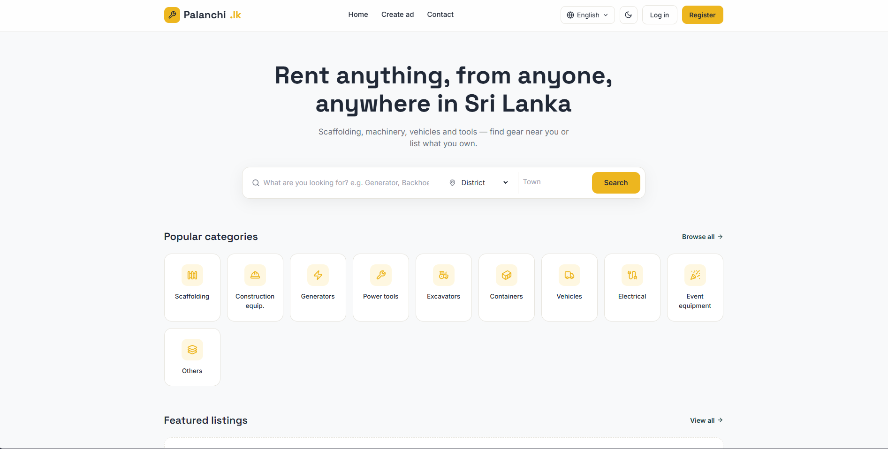
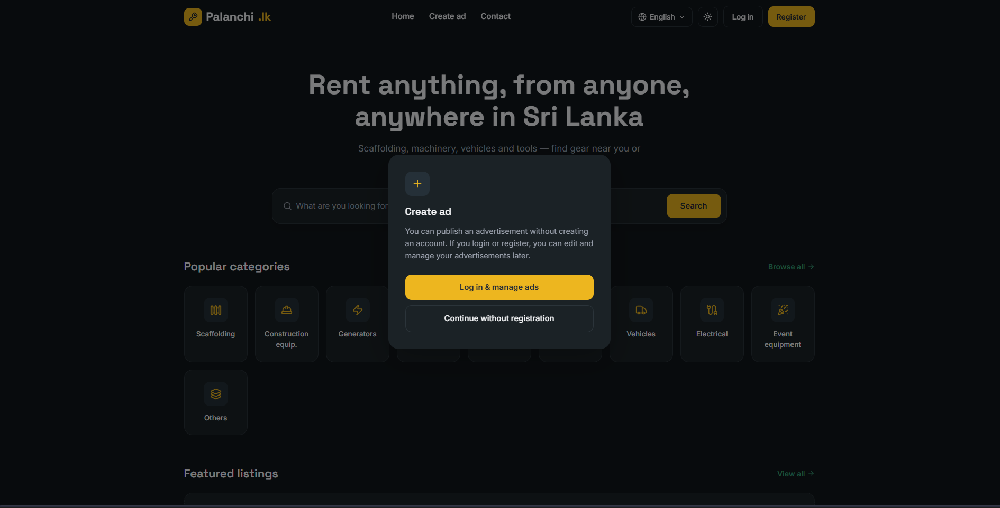
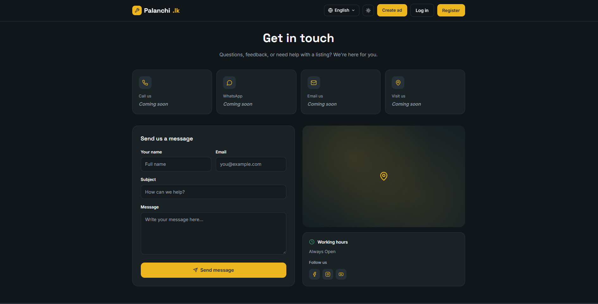
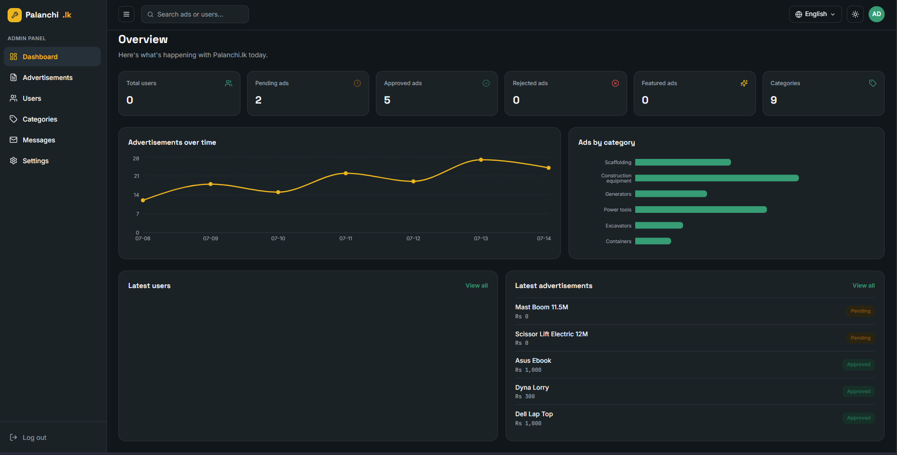

# Palanchi.lk

A peer-to-peer rental marketplace for Sri Lanka. People can list equipment, machinery, vehicles and tools for rent, and others can find them by category and location.

**Live site:** [palanchi.com.lk](https://palanchi.com.lk)

## Screenshots

**Home page.** Search by keyword, district and town, and browse categories.



**Posting an ad (dark mode).** You can post without an account, or log in to edit and manage your ads later.



**Contact page.** Messages sent here are saved for the admin to read.



**Admin panel.** The counters and the "Latest advertisements" list come from the database. The two charts still use built-in sample numbers.



## Features

- **Browse and search.** Search by keyword, category, district and town (Grama Niladhari division). Filter by price range and condition, and sort by newest, oldest or featured.
- **Ad pages.** Each ad has a photo gallery, price and rental period, location, and buttons to call or open WhatsApp. Similar listings appear below.
- **Post an ad.** Logged-in users and guests can both post. Photos are compressed in the browser before upload. Every new ad starts as "pending" and only appears publicly after an admin approves it.
- **Vehicles.** A vehicle can be listed "for rent" (no driver) or "for hire" (with a driver, priced per km).
- **Accounts.** Register and log in with email and password. Users can edit their profile. On the "My ads" page they can see each ad's review status, edit their ads, and delete ads that are still pending or rejected. Editing a live ad sends it back for review.
- **Contact form.** Messages are stored in the database for the admin.
- **Three languages.** English, Sinhala and Tamil.
- **Light and dark mode.** Your choice is remembered in the browser.
- **SEO basics.** Sitemap, robots.txt and Open Graph image.

## Admin panel

The admin panel is protected by a separate admin password, which is set as an environment variable. It can:

- list all ads, and view, approve, reject, suspend, feature/unfeature or delete them
- list registered users and delete a user account
- read contact messages and mark them as read
- show totals for pending, approved, rejected and featured ads

Not finished yet: the "Advertisements over time" and "Ads by category" charts use built-in sample data. The Categories tab shows a fixed list, and its "Add category" button does nothing yet. The Settings tab is a placeholder.

## Tech stack

- **Next.js 14** (App Router) with **React 18** and **TypeScript**
- **Tailwind CSS**, with **lucide-react** icons
- **Supabase**: PostgreSQL database, email/password authentication, and Storage for ad photos. Row Level Security policies are in `supabase/schema.sql`.
- **Recharts** for the admin charts
- Town (GN division) data comes from the `sl-address-utils` npm package (MIT licence).

## Deployment

The live site runs at palanchi.com.lk. The repo has no hosting configuration file, so this README doesn't name a host. The site address is set in `lib/site.ts` and can be overridden with `NEXT_PUBLIC_SITE_URL`.

## Running locally

You need Node.js and your own Supabase project.

1. Run `supabase/schema.sql` in your Supabase project's SQL Editor.
2. Create a `.env.local` file with these variables (use your own values, and never commit this file):
   - `NEXT_PUBLIC_SUPABASE_URL`
   - `NEXT_PUBLIC_SUPABASE_PUBLISHABLE_KEY`
   - `SUPABASE_SERVICE_ROLE_KEY` (server-side only, used by the admin API routes)
   - `ADMIN_PANEL_PASSWORD`
   - `NEXT_PUBLIC_SITE_URL` (optional)
3. Install and start:

```bash
npm install
npm run dev
```

Then open http://localhost:3000.

## Status and limitations

- This is an early version (0.1.0) and a personal project. There are no automated tests.
- Some admin features are unfinished (see "Admin panel" above).
- On the Contact page, the phone, WhatsApp, email and address cards say "Coming soon".
- The admin panel uses one shared password, not individual admin accounts.
- Photo uploads to Storage are open to everyone, because guests can post ads.

## About the author

**Chavindu Jayawardana**, Sri Lanka

- Website: [chavindujayawardana.com.lk](https://www.chavindujayawardana.com.lk)
- LinkedIn: [Chavindu Jayawardana](https://www.linkedin.com/in/chavindu-jayawardana-81a57a334)
